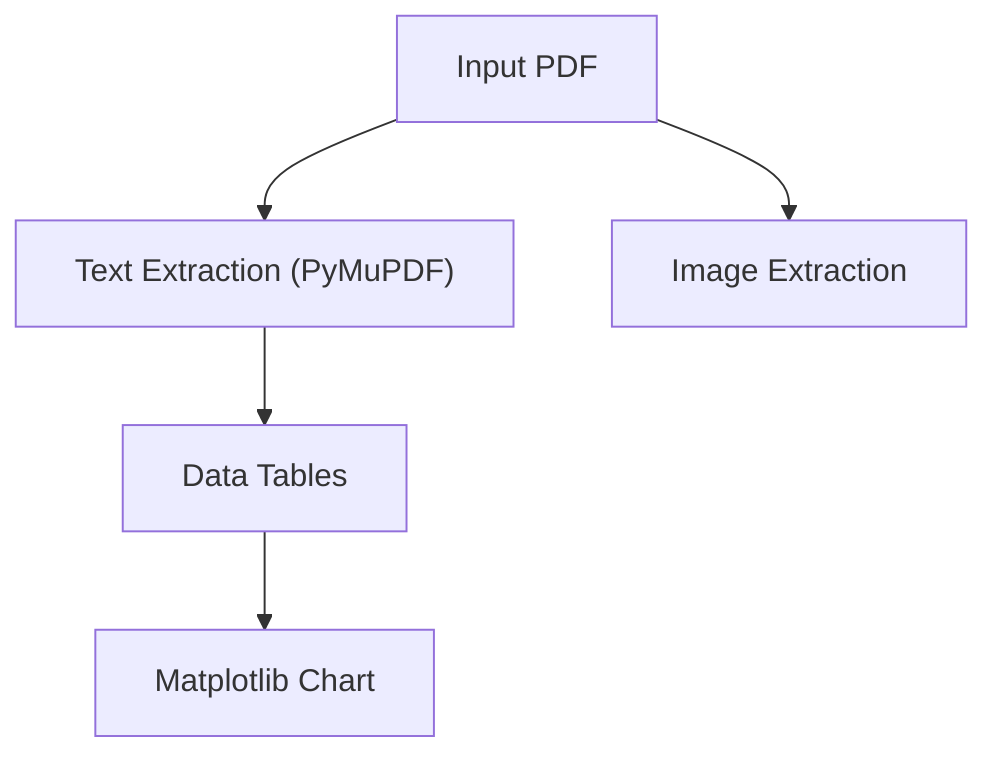

# PDF Reader & Graph Visualizer

Extract text content, tables, and embedded images from PDF documents, and generate clean charts or structural graphs from tabular data.

---

## 1. Extracting Text & Images from a PDF

To parse any PDF into structured text and extract all embedded graphics:

```bash
python3 ~/.hermes/skills/pdf-reader/scripts/parse_pdf.py /path/to/document.pdf --out /tmp/pdf_extracted
```

This will:
- Save full text organized by page to `/tmp/pdf_extracted/extracted_text.md`
- Extract all charts, figures, and raster images to `/tmp/pdf_extracted/images/`

---

## 2. Generating Graphs from Extracted PDF Data

When the PDF contains tabular data, financial figures, or benchmark metrics, you can generate clean visual charts to accompany your summary:

### Bar Chart
```bash
python3 ~/.hermes/skills/pdf-reader/scripts/plot_chart.py '{"title": "Q3 Revenue Comparison", "labels": ["July", "Aug", "Sept"], "values": [120, 145, 180], "x_label": "Month", "y_label": "USD (k)"}' --type bar --out /tmp/revenue_chart.png
```

### Line Chart (Trends)
```bash
python3 ~/.hermes/skills/pdf-reader/scripts/plot_chart.py '{"title": "Model Performance Over Time", "labels": ["v1", "v2", "v3", "v4"], "values": [65.4, 71.2, 79.8, 86.5], "x_label": "Release", "y_label": "Score (%)"}' --type line --out /tmp/trend.png
```

### Pie Chart (Proportions)
```bash
python3 ~/.hermes/skills/pdf-reader/scripts/plot_chart.py '{"title": "Market Share", "labels": ["Product A", "Product B", "Others"], "values": [45, 35, 20]}' --type pie --out /tmp/share.png
```

---

## 3. Structural & Flowchart Graphs (Mermaid)

For architecture, workflows, decision trees, or system relationships described in the PDF, generate native Mermaid diagrams inside your response:

````markdown

````

---

## 4. Inline Custom Python Processing

You can also run ad-hoc Python code to inspect complex PDF structures:

```python
import fitz # PyMuPDF
doc = fitz.open("sample.pdf")
print("Pages:", len(doc))
for page in doc:
    print(page.get_text("blocks")) # structured text blocks
```
